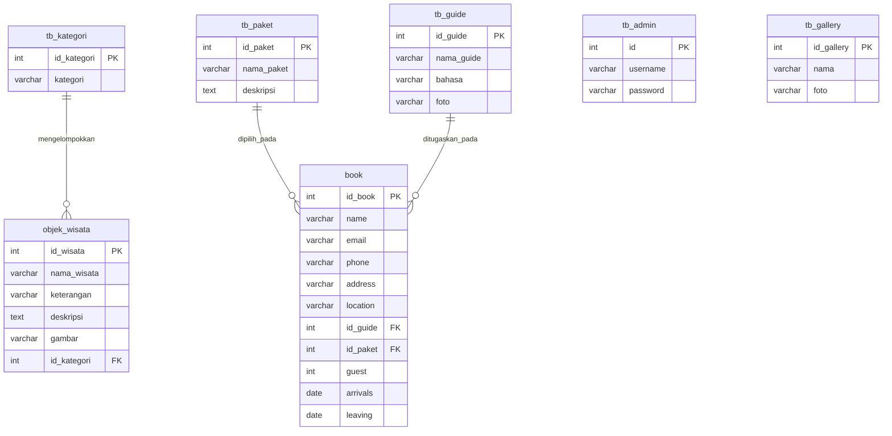
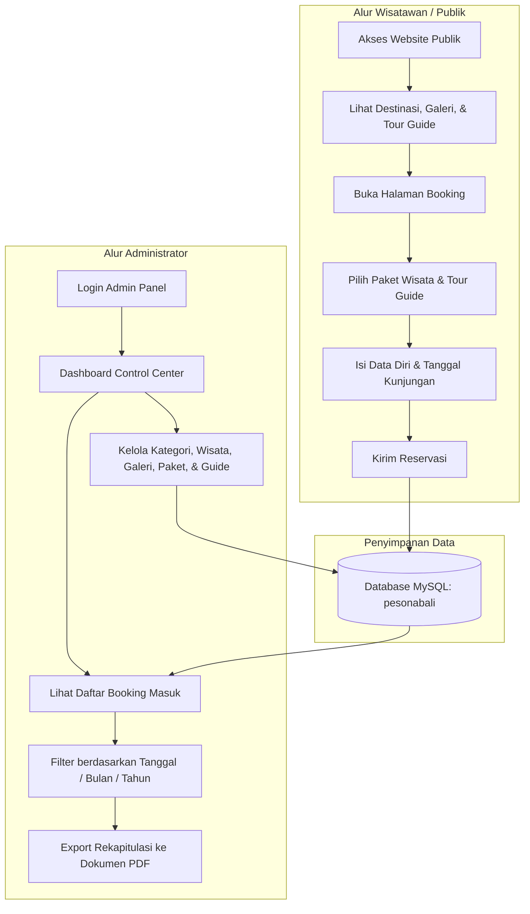

# 🌴 PesonaBali - Tourism Information & Tour Booking System

Aplikasi web portal informasi pariwisata dan reservasi paket tur wisata pulau Bali berbasis **PHP Native** dan **MySQL/MariaDB**. Dilengkapi dengan antarmuka publik yang responsif serta Panel Admin *(Backoffice Control Center)* untuk mengelola seluruh data destinasi, galeri, paket tour, pemandu wisata (guide), serta rekapitulasi data pemesanan (booking) beserta fitur ekspor laporan ke format PDF.

---

## 📌 Daftar Isi
1. [Tentang Proyek](#-tentang-proyek)
2. [Fitur Utama](#-fitur-utama)
3. [Teknologi yang Digunakan](#-teknologi-yang-digunakan)
4. [Struktur Direktori](#-struktur-direktori)
5. [Struktur Database & Skema Relasi](#-struktur-database--skema-relasi)
   - [Diagram Relasi (ERD)](#diagram-relasi-erd)
   - [Spesifikasi Tabel](#spesifikasi-tabel)
6. [Panduan Instalasi & Menjalankan](#-panduan-instalasi--menjalankan)
7. [Akun Default & Akses Sistem](#-akun-default--akses-sistem)
8. [Alur Kerja Sistem (Workflow)](#-alur-kerja-sistem-workflow)

---

## 📖 Tentang Proyek

**PesonaBali** dirancang untuk memudahkan wisatawan lokal maupun mancanegara dalam menjelajahi keindahan alam, budaya, dan kuliner pulau Bali, sekaligus melakukan pemesanan tur secara online. Di sisi lain, pengelola travel/wisata dapat mengelola konten destinasi, kurasi galeri, pembagian paket perjalanan, penugasan tour guide, hingga mengunduh laporan pemesanan secara terpusat.

"(Yang dimana proyek ini adalah proyek pertama merancang website dari nol, oleh karena itu masih terdapat banyak kekurangan)"
---

## ✨ Fitur Utama

### 1. Halaman Publik (Frontend / Wisatawan)
* **Landing Page Interaktif:** Menampilkan informasi umum seputar pulau Bali, layanan unggulan, destinasi pilihan, serta ulasan pelanggan.
* **Katalog Destinasi:** Menampilkan daftar objek wisata yang dikelompokkan berdasarkan kategori (pegunungan, budaya, air, air terjun, dll.) lengkap dengan modal detail info dan harga tiket masuk.
* **Galeri Foto Wisata:** Portofolio visual ragam daya tarik wisata Bali dengan tata letak grid yang rapi.
* **Daftar Pemandu Wisata (Tour Guides):** Menampilkan profil pemandu lokal berlisensi dan kemampuan bahasa asing yang dikuasai.
* **Form Reservasi Online (Booking):** Formulir pemesanan paket tur wisata terintegrasi dengan pemilihan guide, jumlah tamu, serta tanggal kedatangan & kepulangan.
* **Pusat Informasi & FAQ:** Halaman tanya jawab seputar visa, mata uang, cuaca, dan etika berwisata di Bali.

### 2. Panel Administrasi (Backend / Backoffice)
* **Autentikasi Aman:** Sistem proteksi login admin menggunakan sesi PHP (`session_start()`).
* **Manajemen Kategori Wisata:** Fitur Tambah, Edit, dan Hapus (CRUD) kategori destinasi.
* **Manajemen Objek Wisata:** CRUD objek wisata lengkap dengan deskripsi mendalam, penetapan kategori, dan upload file gambar.
* **Manajemen Galeri:** CRUD dokumentasi foto dan keterangan gambar.
* **Manajemen Paket Tour:** CRUD paket perjalanan wisata (contoh: Tur Ubud & Kintamani, Tur Pantai Selatan).
* **Manajemen Tour Guide:** CRUD data pemandu wisata (nama, bahasa yang dikuasai, foto profil).
* **Monitoring & Filter Booking:** Rekapitulasi pesanan masuk dengan fitur filter spesifik berdasarkan **Tanggal**, **Bulan**, dan **Tahun**.
* **Ekspor Laporan PDF:** Cetak rekapitulasi data pesanan booking dalam format dokumen PDF menggunakan FPDF.

---

## 💻 Teknologi yang Digunakan

| Komponen | Teknologi | Deskripsi |
| :--- | :--- | :--- |
| **Backend** | PHP (OOP & Procedural) | Logika pemrosesan server, routing, dan validasi data |
| **Database** | MySQL / MariaDB | Penyimpanan data relasional dan integritas tabel |
| **Frontend Layout**| HTML5 & Bootstrap 5 | Kerangka tampilan responsif mobile-friendly |
| **Styling** | Custom Vanilla CSS | Skema warna tropis modern, typography Google Font Outfit |
| **Icons & Font** | Font Awesome 5/6 & Outfit Font | Tipografi modern dan ikonografi interaktif |
| **PDF Engine** | FPDF (`setasign/fpdf`) | Library PHP untuk pembuatan dokumen PDF laporan booking |
| **Server Lokal** | Laragon / XAMPP / Apache | Lingkungan pengembangan web lokal |

---

## 📂 Struktur Direktori

```text
pesonabali/
│
├── admin/                      # Modul Panel Administrasi (Backoffice)
│   ├── index.php               # Halaman login admin
│   ├── proses-login.php        # Validasi kredensial login admin
│   ├── logout.php              # Mengakhiri session admin
│   ├── header.php & footer.php # Layout template admin
│   ├── home.php                # Dashboard utama admin
│   ├── kategori.php            # Daftar kategori wisata (CRUD)
│   ├── kategori-form.php       # Form tambah/edit kategori
│   ├── kategori-del.php        # Script hapus kategori
│   ├── wisata.php              # Daftar objek wisata (CRUD)
│   ├── wisata-form.php         # Form tambah/edit objek wisata & upload foto
│   ├── wisata-del.php          # Script hapus objek wisata
│   ├── gallery.php             # Daftar galeri foto (CRUD)
│   ├── gallery-form.php        # Form upload foto galeri
│   ├── gallery-del.php         # Script hapus foto galeri
│   ├── paket.php               # Daftar paket tur (CRUD)
│   ├── paket-form.php          # Form tambah/edit paket tur
│   ├── paket-del.php           # Script hapus paket tur
│   ├── guide.php               # Daftar pemandu wisata (CRUD)
│   ├── guide-form.php          # Form tambah/edit guide
│   ├── guide-del.php           # Script hapus guide
│   ├── book.php                # Rekap data booking dengan filter
│   └── export_pdf.php          # Handler generate laporan PDF dari data booking
│
├── public/                     # Modul Antarmuka Publik (Pengunjung)
│   ├── index.php               # Landing page utama
│   ├── destinasi.php           # Katalog objek wisata & modal detail
│   ├── gallery.php             # Galeri visual pariwisata
│   ├── guide.php               # Profil tour guide
│   ├── book.php                # Halaman dan form reservasi booking
│   ├── faqs.php                # Halaman pertanyaan umum (FAQ)
│   ├── header.php & footer.php # Header navigasi & footer publik
│   └── book-form.php           # Komponen form booking
│
├── include/                    # Konfigurasi Inti
│   └── koneksi.php             # Kelas Database Core (MySQLi OOP)
│
├── css/                        # Berkas Stylesheet CSS
│   ├── public-style.css        # Desain frontend publik
│   └── admin-style.css         # Desain dashboard admin
│
├── img/                        # Direktori aset gambar & upload media
├── vendor/                     # Dependensi Composer (FPDF / FPDI)
├── index.php                   # Entry point redirect ke folder public/
├── db_update.php               # Skrip migrasi pembaruan skema database
└── pesonabali.sql              # Berkas dump skema dan data database awal
```

---

## 🗄️ Struktur Database & Skema Relasi

Database utama yang digunakan bernama: `pesonabali`

### Diagram Relasi (ERD)



### Spesifikasi Tabel

#### 1. Tabel `tb_admin`
Menyimpan akun kredensial administrator pengelola sistem.
| Kolom | Tipe Data | Keterangan |
| :--- | :--- | :--- |
| `id` | `INT(11)` | Primary Key, Auto Increment |
| `username` | `VARCHAR(20)` | Username akun admin |
| `password` | `VARCHAR(20)` | Kata sandi akun admin |

#### 2. Tabel `tb_kategori`
Menyimpan kategori klasifikasi destinasi wisata.
| Kolom | Tipe Data | Keterangan |
| :--- | :--- | :--- |
| `id_kategori` | `INT(11)` | Primary Key, Auto Increment |
| `kategori` | `VARCHAR(50)` | Nama kategori (Mountains, Culture, Waters, dll.) |

#### 3. Tabel `objek_wisata`
Menyimpan informasi lengkap objek wisata.
| Kolom | Tipe Data | Keterangan |
| :--- | :--- | :--- |
| `id_wisata` | `INT(11)` | Primary Key, Auto Increment |
| `nama_wisata` | `VARCHAR(50)` | Nama tempat wisata |
| `keterangan` | `VARCHAR(100)` | Deskripsi singkat / highlight |
| `deskripsi` | `TEXT` | Rincian lengkap, info tiket, dan jam operasional |
| `gambar` | `VARCHAR(100)` | Path file gambar objek wisata |
| `id_kategori` | `INT(11)` | Foreign Key berelasi ke `tb_kategori.id_kategori` |

#### 4. Tabel `tb_gallery`
Menyimpan kumpulan foto galeri pariwisata.
| Kolom | Tipe Data | Keterangan |
| :--- | :--- | :--- |
| `id_gallery` | `INT(11)` | Primary Key, Auto Increment |
| `nama` | `VARCHAR(100)` | Judul / nama foto |
| `foto` | `VARCHAR(100)` | Path lokasi file gambar |

#### 5. Tabel `tb_guide`
Menyimpan daftar data tour guide / pemandu wisata.
| Kolom | Tipe Data | Keterangan |
| :--- | :--- | :--- |
| `id_guide` | `INT(11)` | Primary Key, Auto Increment |
| `nama_guide` | `VARCHAR(100)` | Nama lengkap pemandu |
| `bahasa` | `VARCHAR(100)` | Kemampuan bahasa (contoh: English, Indonesian) |
| `foto` | `VARCHAR(100)` | Path foto pemandu wisata |

#### 6. Tabel `tb_paket`
Menyimpan pilihan rute paket perjalanan wisata.
| Kolom | Tipe Data | Keterangan |
| :--- | :--- | :--- |
| `id_paket` | `INT(11)` | Primary Key, Auto Increment |
| `nama_paket` | `VARCHAR(100)` | Nama paket wisata (contoh: Paket Ubud & Kintamani) |
| `deskripsi` | `TEXT` | Rincian rute dan destinasi yang dikunjungi |

#### 7. Tabel `book`
Menyimpan data transaksi reservasi pemesanan tur oleh wisatawan.
| Kolom | Tipe Data | Keterangan |
| :--- | :--- | :--- |
| `id_book` | `INT(255)` | Primary Key, Auto Increment |
| `name` | `VARCHAR(255)` | Nama lengkap pemesan |
| `email` | `VARCHAR(255)` | Alamat email pemesan |
| `phone` | `VARCHAR(20)` | Nomor kontak telepon/WhatsApp |
| `address` | `VARCHAR(255)` | Alamat tempat tinggal / hotel pemesan |
| `location` | `VARCHAR(255)` | Lokasi destinasi tujuan / nama paket manual |
| `id_guide` | `INT(11)` | *Nullable*, Foreign Key relasi ke `tb_guide.id_guide` |
| `id_paket` | `INT(11)` | *Nullable*, Foreign Key relasi ke `tb_paket.id_paket` |
| `guest` | `INT(255)` | Jumlah peserta tur / tamu |
| `arrivals` | `DATE` | Tanggal kedatangan / mulai tur |
| `leaving` | `DATE` | Tanggal kepulangan / selesai tur |

---

## 🚀 Panduan Instalasi & Menjalankan

Ikuti langkah-langkah di bawah ini untuk menjalankan proyek pada server lokal (Laragon / XAMPP):

### 1. Prasyarat Sistem
* PHP versi **7.4** atau **8.x**
* Database **MySQL** atau **MariaDB**
* Apache Web Server
* Web Browser modern (Chrome, Edge, Firefox)

### 2. Penempatan Folder Proyek
Salin seluruh folder proyek ke dalam direktori root server lokal Anda:
* **Laragon:** `C:\laragon\www\pesonabali`
* **XAMPP:** `C:\xampp\htdocs\pesonabali`

### 3. Pembuatan & Impor Database
1. Buka browser dan akses **phpMyAdmin** (`http://localhost/phpmyadmin`).
2. Buat database baru dengan nama: `pesonabali`
3. Pilih menu **Import**, lalu pilih file `pesonabali.sql` yang berada di root folder proyek, kemudian klik **Go** / **Import**.

### 4. Eksekusi Skrip Pembaruan Skema (`db_update.php`)
Proyek ini memiliki skrip pembaharuan struktur tabel untuk modul pemandu wisata dan paket wisata.
1. Jalankan URL berikut di browser Anda:
   ```text
   http://localhost/pesonabali/db_update.php
   ```
2. Pastikan muncul pesan:
   ```text
   Database successfully updated!
   ```
   *(Skrip ini secara otomatis menambahkan tabel `tb_guide`, `tb_paket`, dan memperbarui kolom di tabel `book`)*.

### 5. Konfigurasi Koneksi Database (Jika Diperlukan)
File koneksi database terletak pada [include/koneksi.php](file:///e:/laragon/www/pesonabali/include/koneksi.php). Sesuaikan konfigurasi berikut jika kredensial MySQL lokal Anda berbeda:
```php
class Database {
    private $host = "localhost";
    private $username = "root";     // Sesuaikan dengan user db Anda
    private $password = "";         // Sesuaikan dengan password db Anda
    private $database = "pesonabali";
    ...
}
```

### 6. Akses Aplikasi
* **Halaman Pengunjung (Frontend):**
  ```text
  http://localhost/pesonabali/
  ```
  *(Akan diarahkan secara otomatis ke `http://localhost/pesonabali/public`)*.
* **Halaman Login Admin (Backoffice):**
  ```text
  http://localhost/pesonabali/admin/
  ```

---

## 🔐 Akun Default & Akses Sistem

| Peran (Role) | URL Akses | Username | Password |
| :--- | :--- | :--- | :--- |
| **Administrator** | `http://localhost/pesonabali/admin/` | `admin` | `admin` |
| **Pengunjung / User** | `http://localhost/pesonabali/public/` | *(Tanpa Login)* | *(Tanpa Login)* |

---

## 🔄 Alur Kerja Sistem (Workflow)



---

## 📄 Lisensi & Kontribusi
Proyek ini dikembangkan untuk kebutuhan manajemen paket pariwisata dan edukasi pengembangan web berbasis PHP & MySQL. Anda bebas memodifikasi dan mengembangkan sistem ini sesuai kebutuhan.
